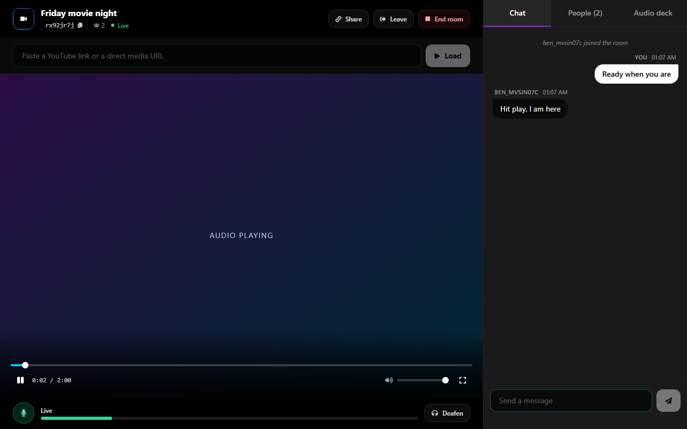
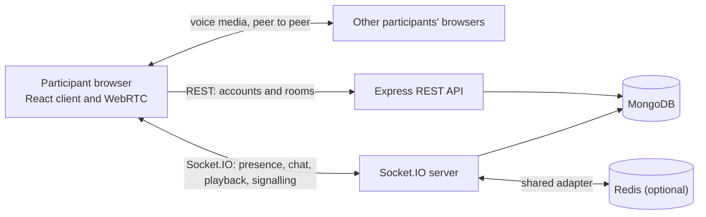

# StreamSync

StreamSync is a real-time watch party. Friends join a room, load a YouTube video or a direct audio or video link, and stay in step while they talk by voice and chat by text.



## Contents

- [Features](#features)
- [Architecture](#architecture)
- [Tech stack](#tech-stack)
- [Getting started](#getting-started)
- [Configuration](#configuration)
- [Usage](#usage)
- [Supported media](#supported-media)
- [API reference](#api-reference)
- [Project structure](#project-structure)
- [Development](#development)
- [Testing](#testing)
- [Deployment](#deployment)
- [Troubleshooting](#troubleshooting)
- [Security](#security)
- [Known limitations](#known-limitations)
- [Contributing](#contributing)

## Features

**Watch together**

- Shared playback for YouTube links (`watch`, `youtu.be`, `embed`, `shorts`, `live`, `music.youtube.com`, `youtube-nocookie.com`, and bare video IDs).
- Direct audio and video links, including HLS (`.m3u8`) streams. See [Supported media](#supported-media).
- Any participant can play, pause, seek, or change the source. Everyone sees the same position.
- The server keeps the authoritative timeline. Clients correct drift larger than 1.5 seconds, checked every 2 seconds.
- Start offsets from links (`t=90`, `t=1m30s`, `start=1:02:03`).
- YouTube quality menu. Your quality preference is stored in this browser.

**Voice and audio deck**

- Peer-to-peer voice over WebRTC. Each pair of participants connects directly, and the server only relays connection setup.
- Open microphone or push to talk (hold `V`).
- Mute (`M`) and deafen (silence all incoming voices on this device).
- Input and output device selection, with echo cancellation, noise suppression, and automatic gain control toggles.
- Live microphone and speaking meters for everyone in the room.
- Per-participant volume and mute on this device.
- Optional ducking: the shared video lowers its volume while someone is speaking.
- If the microphone is blocked or missing, you can still listen and chat, and retry from the voice bar.

**Chat**

- Text messages up to 500 characters, rate limited to protect the room.
- Links in messages are clickable (http and https only).
- The last 200 messages of each room are stored; the latest 100 are sent to anyone who joins.
- Join and leave notices appear in the chat.

**Rooms and accounts**

- Sign up with a username and password, optionally with an email address. Sign in with either username or email.
- Create a room with an optional name, then share its code or invite link.
- Recently visited rooms are listed on the home screen.
- Room owners can remove participants and end the room. Removed participants can rejoin with the room code.
- Rooms persist in MongoDB until the owner ends them.

**Reliability**

- Automatic reconnection. The client rejoins the room and restores presence, chat, and playback state.
- Clear messages for blocked autoplay, blocked or missing microphones, and unavailable media.

## Architecture



- The **client** is a single-page application. It holds the session token, plays media through a common player interface, and runs one WebRTC connection per remote participant.
- The **API** handles accounts and room lookup over REST. Every socket must present a valid session token during the handshake.
- The **Socket.IO server** owns the realtime room protocol. It keeps presence derived from live sockets, stores chat history and the playback timeline in MongoDB, and relays WebRTC signalling between sockets in the same room.
- Voice audio never passes through the server.

## Tech stack

| Layer | Technology |
| --- | --- |
| Client | React 19, TypeScript 5.9, Vite 7, React Router 7, Tailwind CSS 3, react-hot-toast, react-icons |
| Realtime client | socket.io-client 4, native WebRTC, Web Audio API |
| Media | YouTube IFrame API, HTML5 audio and video, hls.js (loaded on demand) |
| Server | Node.js 20.19+ (22 LTS recommended), Express 5, Socket.IO 4, Mongoose 9 |
| Security | JSON Web Tokens, bcryptjs, helmet, express-rate-limit, CORS allowlist |
| Data | MongoDB 7 (verified), optional Redis for Socket.IO scaling |
| Quality | ESLint 9, TypeScript project references, Vitest 5, Node test runner |
| Delivery | Dockerfiles, nginx, Docker Compose, GitHub Actions |

## Getting started

### Prerequisites

- **Node.js 22.12 or newer** for the client, whose test runner (Vitest 5) requires it. The API runs on Node.js 20.19 or newer.
- **npm 10** (bundled with Node.js 22).
- **MongoDB 7**, either a local instance or a hosted connection string.
- A modern Chromium-based browser (Google Chrome or Microsoft Edge). See [Known limitations](#known-limitations).

### 1. Clone the repository

```bash
git clone https://github.com/mayankhansraj12/youtube-streamer.git
cd youtube-streamer
```

### 2. Start the API

```bash
cd server
cp .env.example .env
```

Open `server/.env` and set `MONGODB_URI` and `JWT_SECRET` (at least 16 characters). On Windows PowerShell, use `Copy-Item .env.example .env` instead of `cp`.

```bash
npm ci
npm start
```

The API listens on `http://localhost:5000`. Confirm it with `curl http://localhost:5000/api/health`, which should report `"database":"connected"`.

### 3. Start the client

In a second terminal:

```bash
cd client
cp .env.example .env.local
npm ci
npm run dev
```

Open `http://localhost:5173`, create an account, and create a room. Open a second browser profile or window to join it as another participant.

> The client reads `VITE_BACKEND_URL` at build time. Change it in `.env.local` and restart `npm run dev`.

## Configuration

### API (`server/.env`)

Every variable is validated at startup. A missing or malformed value stops the process with a clear message.

| Variable | Required | Default | Description |
| --- | --- | --- | --- |
| `MONGODB_URI` | Yes | none | MongoDB connection string, for example `mongodb://127.0.0.1:27017/streamsync`. |
| `JWT_SECRET` | Yes | none | Secret for signing session tokens. At least 16 characters; use 32 or more in production. |
| `PORT` | No | `5000` | Port the API listens on. |
| `JWT_EXPIRES_IN` | No | `7d` | Session lifetime in the `ms` format, for example `12h` or `7d`. |
| `CLIENT_ORIGIN` | No | `http://localhost:5173,http://localhost:8080` | Comma-separated browser origins allowed to call the API and open realtime connections. |
| `MAX_ROOM_PARTICIPANTS` | No | `12` | Maximum participants per room, from 2 to 50. |
| `AUTH_RATE_LIMIT` | No | `30` | Login and signup attempts allowed per IP address in a 15-minute window. |
| `TRUST_PROXY` | No | `false` | Set to `true` or a hop count (0 to 10) when the API runs behind a reverse proxy. |
| `REDIS_URL` | No | unset | Enables the Socket.IO Redis adapter so several API instances share realtime state. See [Known limitations](#known-limitations). |
| `NODE_ENV` | No | `development` | Set to `production` in deployments. |

### Client (`client/.env.local`)

Client variables are public. Vite inlines them into the JavaScript bundle, so never put secrets here.

| Variable | Required | Default | Description |
| --- | --- | --- | --- |
| `VITE_BACKEND_URL` | No | `http://localhost:5000` | Public URL of the API. An empty value means the page's own origin. |
| `VITE_ICE_SERVERS` | No | Google STUN servers | JSON array of `RTCIceServer` objects. Add a TURN server here for users behind strict firewalls. |

Example TURN configuration:

```bash
VITE_ICE_SERVERS=[{"urls":"stun:stun.l.google.com:19302"},{"urls":"turn:turn.example.com:3478","username":"user","credential":"secret"}]
```

## Usage

1. **Sign up or sign in.** You can sign in with your username or your email.
2. **Create a room** from the home screen, or enter a room code (or paste an invite link) to join one.
3. **Share the room.** Use **Share** in the header to copy the invite link, or **Copy** the room code.
4. **Load media.** Paste a YouTube link or a direct media URL into the bar above the player and select **Load**. Playback starts for everyone.
5. **Control playback.** Anyone in the room can play, pause, or seek. The position stays synchronized for everyone.
6. **Talk.** Your microphone opens when you join if the browser allows it. Use the voice bar to mute or deafen, and the **Audio deck** tab for devices, push to talk, per-person volume, and ducking.
7. **Chat** in the **Chat** tab.
8. **Manage the room.** Owners see **Remove** next to each participant in the **People** tab, and **End room** in the header.

### Keyboard shortcuts

| Key | Action |
| --- | --- |
| `Space` or `K` | Play or pause the shared media |
| `←` / `→` | Seek back or forward 5 seconds |
| `M` | Mute or unmute your microphone |
| `V` (hold) | Talk while in push-to-talk mode |
| `F` | Enter or leave full screen |

Shortcuts are ignored while you type in a text field or a menu.

## Supported media

| Input | Treated as | Notes |
| --- | --- | --- |
| `https://www.youtube.com/watch?v=ID` | YouTube | Also `m.youtube.com`, `music.youtube.com`, `youtube-nocookie.com`. |
| `https://youtu.be/ID` | YouTube | Short links. |
| `/embed/ID`, `/shorts/ID`, `/live/ID`, `/v/ID` | YouTube | Canonicalized to the watch URL on the server. |
| `ID` (11 characters) | YouTube | Bare video ID. |
| `http(s)://…/file.mp4`, `.webm`, `.ogv`, `.mov`, `.m4v` | HTML5 video | Playback depends on the browser's codec support. |
| `http(s)://…/file.mp3`, `.m4a`, `.aac`, `.wav`, `.flac`, `.oga`, `.ogg`, `.opus` | HTML5 audio | Shown with an audio placeholder. |
| `http(s)://…/stream.m3u8` | HLS | Native where supported; otherwise hls.js is loaded on demand. |
| Any other `http(s)` URL | HTML5 video | Attempted as video; the browser decides whether it can play. |

Links with embedded credentials, non-HTTP schemes, or more than 2048 characters are rejected. Start offsets come from `t` (or `start` for YouTube).

## API reference

Base URL: the API origin, for example `http://localhost:5000`.

### REST

Authenticated routes accept `Authorization: Bearer <token>`.

| Method | Path | Auth | Description |
| --- | --- | --- | --- |
| `GET` | `/api/health` | No | Database state and uptime. Returns `503` when the database is unreachable. |
| `POST` | `/api/auth/signup` | No | Body: `username`, `password`, optional `email`. Returns `201` with `{ token, user }`. |
| `POST` | `/api/auth/login` | No | Body: `identifier` (username or email) and `password`. Returns `{ token, user }`. |
| `GET` | `/api/auth/me` | Yes | Returns `{ user }` for the session. |
| `POST` | `/api/rooms` | Yes | Body: optional `name`. Returns `201` with the room. |
| `GET` | `/api/rooms/:roomId` | Yes | Returns the room, or `404`. |
| `DELETE` | `/api/rooms/:roomId` | Owner | Ends the room. Participants receive `room:ended`. Returns `204`. |

Errors use one shape: `{ "code": "…", "message": "…" }`.

| Code | HTTP status | Meaning |
| --- | --- | --- |
| `VALIDATION_ERROR` | 400 | A field failed validation. |
| `INVALID_JSON` | 400 | The request body is not valid JSON. |
| `INVALID_SOURCE` | 400 | A playback link is not supported. |
| `INVALID_CREDENTIALS` | 401 | Wrong username, email, or password. |
| `UNAUTHORIZED` | 401 | The session is missing, invalid, or expired. |
| `FORBIDDEN` | 403 | The action is limited to the room owner. |
| `ROOM_NOT_FOUND` / `NOT_FOUND` | 404 | The room or route does not exist. |
| `USERNAME_TAKEN` / `EMAIL_TAKEN` | 409 | The account already exists. |
| `ROOM_FULL` / `NOT_IN_ROOM` / `NO_MEDIA` | 409 | The room is at capacity, you are not in it, or no media is loaded. |
| `PAYLOAD_TOO_LARGE` | 413 | The request body exceeds 16 KB. |
| `RATE_LIMITED` | 429 | Too many attempts or actions. |
| `INTERNAL_ERROR` | 500 | Unexpected server error. |

### Realtime (Socket.IO)

Connect with the session token in the handshake: `io(API_URL, { auth: { token } })`. A rejected token produces a `connect_error` with the message `UNAUTHORIZED`.

Client events. Events with an acknowledgement return `{ ok: true, … }` or `{ ok: false, code, message }`.

| Event | Payload | Acknowledgement | Notes |
| --- | --- | --- | --- |
| `room:join` | `{ roomId, muted? }` | `{ selfId, snapshot }` | Joins a room and returns participants, recent messages, playback state, and server time. |
| `room:leave` | none | `{}` | Leaves the current room. |
| `room:mute` | `{ muted }` | `{}` | Updates your mute state for everyone. |
| `room:kick` | `{ socketId }` | `{}` | Owner only. Removes a participant. |
| `chat:send` | `{ text }` | `{ message }` | Rate limited. |
| `playback:set-source` | `{ url }` | `{ playback }` | Owner or any participant. Starts playback. |
| `playback:control` | `{ playing, position }` | `{ playback }` | Position in seconds. |
| `rtc:signal` | `{ to, description?, candidate? }` | none | Relayed to `to` within the same room. |

Server events:

| Event | Payload |
| --- | --- |
| `presence:update` | `{ participants, event? }` where `event` is `{ type: "joined" \| "left", participant }` |
| `chat:message` | `{ id, userId, username, text, createdAt }` |
| `playback:state` | `{ source, playing, position, updatedAt }` (`updatedAt` is server time in milliseconds) |
| `rtc:signal` | `{ from, description?, candidate? }` |
| `room:kicked` | `{ roomId }` |
| `room:ended` | `{ roomId, reason }` |

Socket error codes match the REST table (`NOT_IN_ROOM`, `ROOM_FULL`, `RATE_LIMITED`, and so on).

## Project structure

```
.
├── .github/workflows/      CI (tests, lint, type check, build) and CD (image publishing on version tags)
├── assets/                 Images used by this README
├── client/                 React single-page application (Vite)
│   ├── public/             Static files served as they are
│   ├── src/
│   │   ├── components/     Shared UI and room components
│   │   ├── context/        Session and realtime connection providers
│   │   ├── hooks/          Room session, voice, playback, and settings hooks
│   │   ├── lib/            API and socket clients, voice mesh, utilities, unit tests
│   │   ├── pages/          Login, signup, home, room, and not-found pages
│   │   └── player/         Playback adapters for YouTube and HTML5 media
│   ├── Dockerfile          Multi-stage build served by nginx
│   ├── nginx.conf          Static hosting with SPA fallback and caching headers
│   └── vite.config.ts      Build, dev server, and preview configuration
├── server/                 Express and Socket.IO API
│   ├── src/
│   │   ├── index.js        Entry point: database, HTTP, sockets, graceful shutdown
│   │   ├── app.js          Express application factory
│   │   ├── config.js       Validated environment configuration
│   │   ├── db.js           MongoDB connection
│   │   ├── lib/            Validation, media parsing, identifiers, rate limiting, tokens
│   │   ├── middleware/     Authentication and error handling
│   │   ├── models/         User and Room schemas
│   │   ├── routes/         REST routes for auth and rooms
│   │   ├── services/       Room persistence and response shaping
│   │   └── socket/         Socket.IO handshake and room protocol
│   ├── test/               Unit and integration tests (node:test)
│   └── Dockerfile          Production image with production dependencies only
├── docker-compose.yml      MongoDB, API, and client for a single-host deployment
├── .env.example            Variables read by docker-compose.yml
└── README.md
```

## Development

### API

| Command | Description |
| --- | --- |
| `npm start` | Runs the API (`node src/index.js`). |
| `npm run dev` | Runs the API and restarts on file changes (`node --watch`). |
| `npm test` | Runs every unit and integration test. |
| `npm run test:unit` | Runs the unit tests only. |

### Client

| Command | Description |
| --- | --- |
| `npm run dev` | Starts the Vite development server on port 5173. |
| `npm run build` | Type checks and produces an optimized bundle in `dist/`. |
| `npm run preview` | Serves the production bundle locally on port 4173. |
| `npm run lint` | Runs ESLint with React Hooks and React Refresh rules. |
| `npm run typecheck` | Runs the TypeScript project build without emitting files. |
| `npm test` | Runs the Vitest unit tests. |

## Testing

- **API unit tests** cover media-link parsing, validation rules, room identifiers, the rate limiter, session tokens, origin checks, and configuration validation.
- **API integration tests** start the real Express and Socket.IO stack against an in-memory MongoDB. They cover signup and login, room lifecycle, presence, chat, playback synchronization, WebRTC signal isolation, rate limits, room capacity, owner moderation, and relay ordering.
- **Client unit tests** cover playback clock arithmetic, clock offset estimation, time formatting, chat link splitting, persisted settings sanitization, and the recent-rooms list.

Run everything:

```bash
cd server && npm test
cd ../client && npm run lint && npm run typecheck && npm test
```

The integration tests download a MongoDB binary through `mongodb-memory-server` on first run. To use an existing database instead, set `MONGODB_URI_TEST` to a dedicated test database. The tests create and reuse their own accounts, but they do not clean the database afterwards.

Browser-level end-to-end tests are not part of this repository yet.

## Deployment

### Frontend

1. Set `VITE_BACKEND_URL` to the public URL of the API.
2. Build with `npm run build` in `client/`.
3. Serve `client/dist/` from any static host. The app uses client-side routes, so configure a fallback to `index.html`. `client/vercel.json` provides this for Vercel, and `client/nginx.conf` provides it for nginx.

### Backend

1. Install production dependencies with `npm ci --omit=dev` in `server/` and run `npm start` on Node 20.19 or newer.
2. Set `MONGODB_URI`, `JWT_SECRET`, and `CLIENT_ORIGIN` to your frontend's origin.
3. Behind a reverse proxy, set `TRUST_PROXY` and make sure the proxy forwards WebSocket upgrades for `/socket.io/`.
4. Serve both the API and the client over HTTPS. Browsers only allow microphone access in a secure context; `localhost` is the only exception during development.

### Containers

`docker-compose.yml` runs MongoDB 7, the API, and the client behind nginx:

```bash
cp .env.example .env        # set JWT_SECRET
docker compose up --build
```

The client is served on `http://localhost:8080` and the API on `http://localhost:5000`. The compose file sets `CLIENT_ORIGIN` to the client address and passes `VITE_BACKEND_URL` into the client build.

## Troubleshooting

- **The microphone is blocked.** Allow microphone access for the site in your browser settings, then select **Retry** in the voice bar. You can still listen and chat without it.
- **Autoplay was blocked.** Select the play overlay on the player once to start playback.
- **The YouTube player does not load.** An ad blocker or a restrictive network may block `youtube.com`. Also check that the uploader allows embedding.
- **Voice does not connect.** Both participants need an open path to each other. Behind strict firewalls or symmetric NAT, configure a TURN server with `VITE_ICE_SERVERS`.
- **The API will not start.** The message names the missing or invalid variable. `JWT_SECRET` must be at least 16 characters.

## Security

- Passwords are hashed with bcrypt (cost 12) and must be 8 to 72 bytes. The API never returns password hashes.
- Sessions are signed JSON Web Tokens with an explicit HS256 algorithm check.
- Every realtime connection is authenticated during the handshake. Identity comes from the token, not from client-supplied fields.
- Room actions check membership, and owner actions check ownership on the server.
- Login and signup are rate limited per IP address. Chat, playback, and signalling events are rate limited per socket.
- Request bodies are limited to 16 KB, realtime payloads to 256 KB, and inputs are validated and normalized.
- helmet sets security headers, and CORS only allows configured origins.
- Secrets live in environment variables. `.env` files are ignored by Git.

To report a vulnerability, contact the maintainer privately rather than opening a public issue.

## Known limitations

- **Voice is a full mesh.** Every participant connects to every other participant, so bandwidth and CPU grow with room size. The default cap is 12 participants.
- **No TURN server by default.** Connections use STUN only, so some networks cannot carry voice until you configure TURN.
- **YouTube depends on the uploader.** Videos that disable embedding or are private, removed, or age-restricted cannot play in the room.
- **Shared control.** Any participant can change the media and control playback for everyone. The app has no host-only playback mode.
- **Sessions are not revoked.** Signing out clears the token in the browser, but tokens remain valid until they expire (`JWT_EXPIRES_IN`). Tokens are stored in `localStorage`.
- **Rate limits are per process.** Login and signup limits are kept in memory, so several API instances each enforce their own limit.
- **Redis is optional and untested here.** `REDIS_URL` enables the Socket.IO Redis adapter. The repository's tests do not exercise it.
- **Browser coverage.** Chromium-based browsers are the only ones this project has been exercised in.
- **No account recovery.** Password reset and email verification are not implemented.

## Contributing

Contributions are welcome. Read [CONTRIBUTING.md](CONTRIBUTING.md) for the development workflow and the checks each change should pass.
